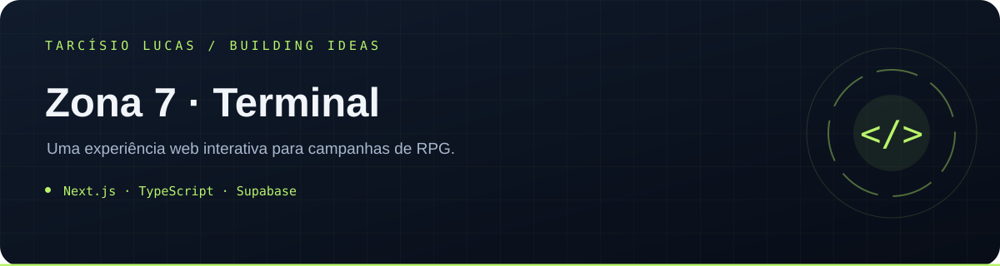

<p align="center"></p>

<p align="center"><a href="https://github.com/T-Lucas43">Perfil</a> · <a href="https://github.com/T-Lucas43?tab=repositories">Mais projetos</a> · <a href="https://www.linkedin.com/in/tarcisio-lucas-io">LinkedIn</a></p>

---

# Zona 7 - Terminal

Aplicação web completa para a campanha **Zona 7: A Convergência**, com áreas separadas para mestre e jogador, fichas interativas, sessão ao vivo, recursos transacionais, alertas, habilidades, dados, mensagens privadas, combate, pistas e auditoria.

## Estado da entrega

- Interface responsiva em pt-BR para 375px e 1440px.
- Modo de demonstração local sem credenciais, acessível pela tela de login.
- Autenticação SSR por cookies com Supabase Auth quando as variáveis estão configuradas.
- Schema PostgreSQL, RLS, Storage privado, Realtime, funções transacionais e seed idempotente.
- Parser e rolador de dados server-side sem `eval`.
- API protegida para mutações de recurso e Vercel Cron.
- Seis fichas completas no seed: Davi, Magnus, Arya, Lize, Amber e Gragas, todos jogáveis. Rivaldo é uma entidade separada ligada a Gragas.
- Console do mestre para editar identidade, retrato, recursos, medidor, notas, perícias, ações, fraquezas, progressão de habilidades e exatamente quais campos/seções aparecem para cada jogador.
- Criação de novos personagens jogáveis, vínculo com contas, inventário e pistas entregues pelo mestre com notificação individual.
- Central única da sessão com roteiro privado antes do editor, mapa ampliável, tokens isométricos com retratos, elenco clicável, ações rápidas, dano, cura, recursos, ocultação no mapa, mensagens, entregas e conteúdo público.
- Contas e convites com senha temporária obrigatoriamente trocada no primeiro acesso, criação, suspensão e atribuição, troca ou remoção de personagem pelo mestre.
- Remetentes aparentes configuráveis, tema, módulos, regras, campos personalizados, entidades e NPCs com retratos próprios e inserção na cena para o mestre ou para todos.
- Roteiros `.z7.md`/`.z7.json`, importação assistida de TXT/DOCX/PDF, validação segura, simulação, publicação e execução sequenciada.
- Testes Vitest, Playwright e pgTAP para políticas do banco.

O modo de demonstração serve para avaliação visual e de interação. Persistência real, convites por e-mail, canais privados, uploads permanentes e testes de RLS exigem um projeto Supabase configurado. O mestre acessa e administra contas, papéis, vínculos e redefinição de senha; senhas nunca são exibidas nem armazenadas pela aplicação.

## Requisitos

- Node.js 22 ou superior.
- pnpm 11.
- Supabase CLI para banco local/produção.
- Conta Vercel para publicação.

## Execução local imediata

```bash
pnpm install
pnpm dev
```

Acesse `http://localhost:3000/login` e escolha **Mestre** ou **Jogador**. Sem variáveis do Supabase, o terminal entra automaticamente no modo local e não grava dados permanentes.

## Execução com Supabase

1. Copie `.env.example` para `.env.local`.
2. Preencha `NEXT_PUBLIC_SUPABASE_URL`, `NEXT_PUBLIC_SUPABASE_PUBLISHABLE_KEY` e `SUPABASE_SERVICE_ROLE_KEY`.
3. Aplique as migrations e o seed conforme [docs/SUPABASE.md](docs/SUPABASE.md).
4. Defina as variáveis `SEED_MASTER_EMAIL` e `SEED_MASTER_PASSWORD` e execute `pnpm db:seed`.
5. Inicie com `pnpm dev`.

Nunca exponha `SUPABASE_SERVICE_ROLE_KEY`, `CRON_SECRET` ou `WEB_PUSH_PRIVATE_KEY` em variáveis públicas.

## Scripts

| Comando          | Finalidade                                          |
| ---------------- | --------------------------------------------------- |
| `pnpm dev`       | Desenvolvimento local                               |
| `pnpm build`     | Build de produção                                   |
| `pnpm start`     | Servidor de produção                                |
| `pnpm lint`      | Regras estáticas                                    |
| `pnpm typecheck` | TypeScript estrito                                  |
| `pnpm test`      | Testes unitários e integração                       |
| `pnpm test:e2e`  | Fluxos Playwright desktop e mobile                  |
| `pnpm db:seed`   | Cria usuários opcionais e aplica o conteúdo inicial |

## Variáveis de ambiente

| Variável                               |        Obrigatória | Exposição      | Uso                                        |
| -------------------------------------- | -----------------: | -------------- | ------------------------------------------ |
| `NEXT_PUBLIC_APP_URL`                  |    Sim em produção | Pública        | URL canônica e callbacks                   |
| `NEXT_PUBLIC_SUPABASE_URL`             |   Sim no modo real | Pública        | Endpoint do Supabase                       |
| `NEXT_PUBLIC_SUPABASE_PUBLISHABLE_KEY` |   Sim no modo real | Pública        | Cliente com RLS                            |
| `SUPABASE_SERVICE_ROLE_KEY`            | Sim para seed/cron | Servidor       | Administração controlada                   |
| `SUPABASE_PROJECT_ID`                  |           Opcional | Servidor/CI    | Automação da CLI                           |
| `CRON_SECRET`                          |      Sim para cron | Servidor       | Bearer token da rota protegida             |
| `SEED_MASTER_EMAIL`                    |           Opcional | Servidor local | Mestre de demonstração                     |
| `SEED_MASTER_PASSWORD`                 |           Opcional | Servidor local | Senha inicial forte                        |
| `SEED_PLAYER_EMAILS`                   |           Opcional | Servidor local | Até seis jogadores, separados por vírgula  |
| `WEB_PUSH_PUBLIC_KEY`                  |           Opcional | Pública        | Push futuro                                |
| `WEB_PUSH_PRIVATE_KEY`                 |           Opcional | Servidor       | Assinatura de push                         |

## Documentação

- [Arquitetura](docs/ARCHITECTURE.md)
- [Banco e entidades](docs/DATABASE.md)
- [Políticas RLS](docs/RLS.md)
- [Catálogo Realtime](docs/REALTIME.md)
- [Configuração do Supabase](docs/SUPABASE.md)
- [Deploy na Vercel](docs/VERCEL.md)
- [Guia do mestre](docs/MASTER_GUIDE.md)
- [Guia do jogador](docs/PLAYER_GUIDE.md)
- [Fichas, mídia, mapas e roteiros](docs/CHARACTERS_AND_SCRIPTS.md)

## Segurança por padrão

- Papéis pertencem à campanha, não ao perfil global.
- Notas do mestre, remetente real, conteúdo protegido de mensagens e arquivos privados ficam em tabelas separadas.
- A sala do jogador lê `session_public_state`, o mapa publicado e somente atores/tokens autorizados; o roteiro e as notas do mestre nunca compõem esse DTO.
- A ficha do jogador é montada por `get_player_character_sheet`, que mascara no banco os campos e seções ainda não liberados pelo mestre.
- Entregas, visibilidade de personagens e criação de fichas usam RPCs transacionais e auditadas.
- Recursos só mudam pela função transacional `mutate_character_resource`.
- Alertas são gerados ao cruzar o limite, desarmados abaixo dele e rearmados somente após recuperação.
- Desfazer nunca apaga o evento original; cria compensação e bloqueia dependências posteriores.
- Dados são rolados no servidor com `node:crypto`.
- Convites guardam apenas SHA-256 do token e expiram em 72 horas por padrão.

## Publicação

O projeto está preparado para Vercel, sem filesystem persistente. Uploads ficam no Supabase Storage. A rota `/api/cron/process-events` exige `Authorization: Bearer <CRON_SECRET>` e o cron diário compatível com o plano Hobby funciona apenas como rede de segurança; os eventos da sessão são processados também pelo painel autenticado para precisão curta.

Consulte [docs/VERCEL.md](docs/VERCEL.md) antes de publicar.
